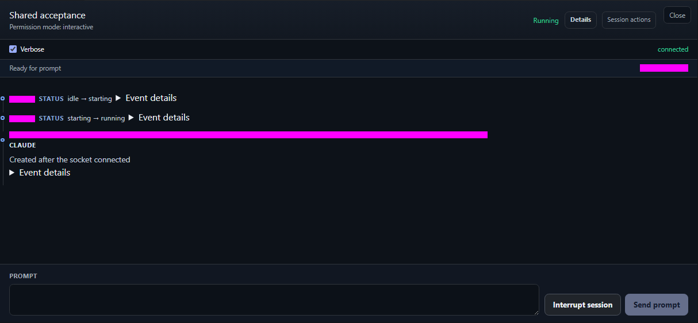

# Mesh

Run, observe, and steer Claude coding sessions on your own machine.

Mesh is a local TypeScript platform for coordinating coding work across Git
repositories, with durable session history and explicit human approval controls.



_A committed acceptance-test capture using the fake agent driver and test data._

## Engineering focus

- **Durable sessions:** SQLite event storage, ordered events, and WebSocket replay
  and resynchronization keep session history separate from transient streaming UI.
- **Controlled execution:** shared contracts, lifecycle transitions, permission
  decisions, and human plan approval make agent actions observable.
- **Repository workflows:** imported local Git projects, isolated worktrees,
  Plan/Board/Sessions views, task attempts, and QA support bounded coding work.
- **Local operation:** Fastify and React run on your machine. Live sessions use
  the installed Claude subscription and consume its quota; there is no automatic
  fallback to API billing.

This is a development project. The established V1 platform and the experimental
V2 workflow have separate apps, ports, and databases. V2 release gates remain work
in progress; see [V2 foundation](docs/development/v2-foundation.md).

## Run locally

Use Node.js 24, pnpm 10 through Corepack, and Git. Live agent sessions also require
an authenticated local Claude installation.

```text
corepack pnpm install --frozen-lockfile
```

Start the API and web app in separate terminals:

```text
corepack pnpm nx dev server
corepack pnpm nx dev web
```

Open `http://127.0.0.1:4200` (API: port 3737). Follow the
[session platform guide](docs/development/session-platform.md) for operating modes
and the opt-in live smoke test.

## Verify and explore

```text
corepack pnpm exec playwright install chromium
corepack pnpm verify
```

The verification suite uses fake agents, temporary repositories, and temporary
databases. It does not exercise a live Claude subscription. The
[CI workflow](.github/workflows/ci.yml) runs formatting, lint, type checks, tests,
builds, and browser acceptance tests.

See the [architecture](docs/development/architecture.md) for component boundaries
and the command, persistence, and event flow.
