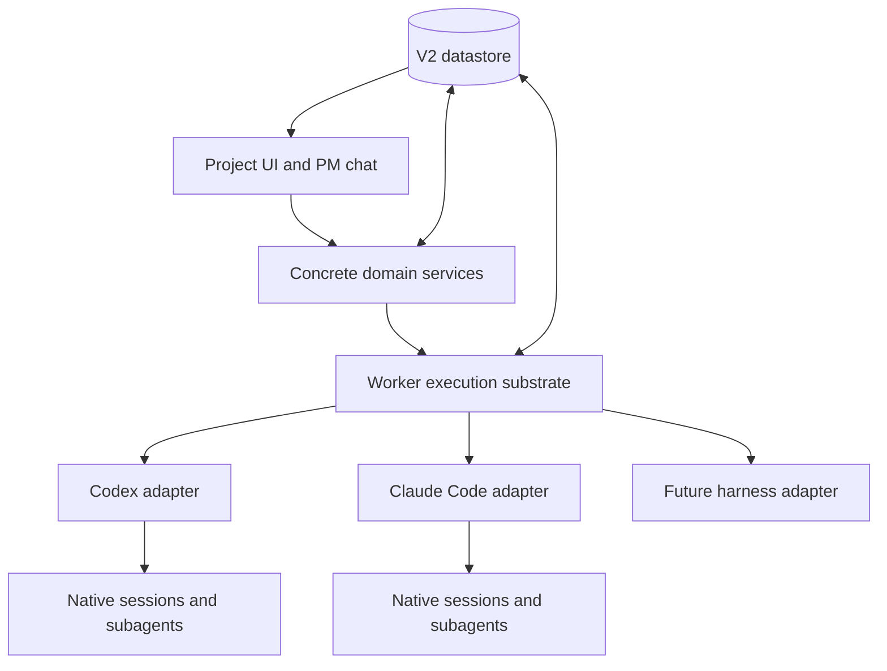

# Mesh V2 Architecture

**Status:** Work in progress for maintainer review

**Date:** 2026-08-27

**Decision:** Build V2 in parallel with V1 in the same monorepo, using a fresh
datastore and reusing proven mechanisms only behind V2 concepts.

## Summary

Mesh V2 is a project-focused environment for turning a product idea into
approved, traceable requirements and then coordinating multiple coding-agent
workers toward those requirements in parallel. It is deliberately independent
of any one agent harness, model, or provider.

The operator begins by selecting a repository. That project then becomes the
focus of the application. A persistent Project Manager (PM) agent helps the
operator clarify intent, proposes requirements and plans, and coordinates
workers. The operator retains approval authority over canonical project intent,
meaningful scope changes, and unsafe or irreversible actions.

Top-level workers are durable Mesh executions. They may use Codex, Claude Code,
or another installed subscription-backed harness. Harness-native subagents are
observable child activities, not independent owners of Mesh tasks. This split
allows different workers to use different models and harnesses without making
Mesh's product model depend on their implementation details.

The core product principle is:

> Approved requirements are canonical project intent. Conversations,
> specifications, milestones, tasks, implementations, and evidence are
> projections or consequences of that intent.

## Goals

- Let an operator describe an application conversationally and refine it with a
  PM that asks useful clarifying and expansion questions.
- Represent approved intent as reviewable, revisioned, atomic requirements with
  explicit relationships and provenance.
- Plan and execute dependency-ready work across multiple milestones rather than
  forcing one milestone per session.
- Run multiple workers concurrently through different harnesses and models.
- Automate branch and worktree management while preserving real user work.
- Make authority, approvals, lifecycle transitions, evidence, and failure states
  durable and visible.
- Keep all normal execution local and subscription-backed; never silently enable
  pay-per-token API billing.
- Allow global Mesh worker profiles and project-specific specialization through
  simple, schema-validated structured text.

## Non-goals

- A general-purpose workflow engine whose nodes and edges can express arbitrary
  business processes.
- Automatic acceptance of an agent's plan, requirements, or implementation.
- Treating chat transcripts, process exit codes, or provider session IDs as
  canonical project state.
- Giving harness-native subagents independent task claims or worktrees by
  default.
- Migrating the V1 datastore or preserving its domain model for compatibility.
- Cross-project portfolio management, continuous autonomous scheduling, or
  configurable authoritative gates in the initial V2 release.

## Architectural Principles

1. **Project first.** The selected repository is the application context. Users
   should not manually create or name sessions, worktrees, or branches during
   normal operation.
2. **Durable before optimistic.** Commands, normalized events, proposals,
   approvals, and external-operation intent are persisted before UI publication
   or consequential side effects.
3. **Authority is explicit.** A prompt or profile can provide expertise, but it
   cannot grant lifecycle authority.
4. **Intent is revisioned.** Executions operate against frozen requirement,
   task, profile, and repository revisions.
5. **Harnesses are replaceable.** Domain services see Mesh execution IDs and
   normalized events, never provider-native session concepts.
6. **Ambiguity preserves work.** Unknown ownership, dirty workspaces, and
   incomplete reconciliation stop automatic cleanup.
7. **Concrete workflows first.** Planning, development, QA, and integration are
   explicit domain services sharing a small execution substrate. V2 does not
   begin as a configurable pipeline framework.
8. **Reuse mechanisms, redesign concepts.** V1 code is a source of proven
   techniques, not a compatibility constraint.
9. **Workflow semantics belong to Mesh.** Skills are pluggable execution
   strategies that may improve worker behavior, but durable Mesh domain
   workflows remain authoritative and available without any particular skill
   package.

## Product Workflow

```mermaid
flowchart LR
    Human[Operator] <--> PM[Project Manager]
    PM --> Discovery[Discovery and advisory work]
    Discovery --> Proposal[Intent and requirement proposal]
    Proposal -->|human approval| Ledger[Requirement Ledger]
    Ledger --> Plan[Milestones, tasks, dependencies]
    Plan -->|human approval| Run[Finite execution run]
    Run --> Dev[Developer attempts]
    Dev --> QA[QA attempts]
    QA -->|rework| Dev
    QA --> Integration[Integration authority]
    Integration --> Evidence[Evidence and requirement coverage]
    Evidence --> PM
```



### Discovery and planning

The PM is the persistent human-facing agent. The operator describes a desired
outcome in natural language. The PM asks clarifying questions when ambiguity
would materially change behavior, scope, risk, cost, or architecture. It may
also ask expansion questions, but must disclose their scope or cost impact.

Ordinary technical choices belong to the PM and specialist agents, with their
rationale recorded. Other agents report to the PM instead of independently
interrupting the operator. The PM can request bounded research, product,
architecture, UX, security, or performance assignments before preparing a
proposal.

Planning has two approval boundaries:

1. The PM proposes a revisioned `ProjectIntent` and Requirement Ledger changes.
2. After intent approval, the PM proposes milestones, tasks, dependencies, and
   requirement coverage.

Approval applies the full proposal atomically. Rejection or revision leaves the
previous canonical state intact. The PM cannot approve its own proposal,
silently expand scope, or launch execution without authorization.

### Project intent

`ProjectIntent` is a concise, revisioned project brief containing:

- goal and target users;
- desired capabilities;
- constraints and non-goals;
- success conditions;
- source material and rationale.

It provides narrative coherence around the Requirement Ledger. It does not
replace the ledger or become an unstructured source of hidden obligations.

## Requirement Ledger

The Requirement Ledger is the canonical structured representation of approved
project intent. A requirement is one independently reviewable obligation with
one approval decision. Atomic does not necessarily mean one sentence.

### Record types

V2 distinguishes concepts that are commonly mixed together in prose:

- **Requirement:** an obligation the delivered project must satisfy.
- **Decision:** an approved choice that constrains the solution.
- **Assumption:** a belief being used until confirmed or invalidated.
- **Question:** unresolved information needed for planning or execution.
- **Risk:** a possible adverse outcome and its mitigation or acceptance.
- **Milestone:** an outcome-oriented delivery boundary.
- **Task:** a bounded unit of implementation or verification work.
- **Evidence:** an artifact or observation supporting a claim.

Each requirement has a stable identity and immutable revisions. A revision
records its project, kind, status, statement, rationale, priority, provenance,
and approval metadata. Initial kinds are functional, quality, UX, safety,
operational, and constraint. Initial statuses are proposed, approved,
superseded, rejected, and retired.

### Relationships and traceability

Requirement-to-requirement relationships initially support:

- `refines`;
- `depends_on`;
- `conflicts_with`;
- `supersedes`;
- `duplicates`.

Traceability is modeled separately:

- a milestone covers a requirement;
- a task satisfies a requirement revision;
- evidence verifies a requirement revision or acceptance criterion;
- a decision constrains a requirement, milestone, or task;
- a record derives from source material or a conversation turn.

This distinction keeps the requirement graph meaningful while supporting
coverage and impact analysis. Removal is normally represented by rejection,
supersession, or retirement so history and downstream impact remain visible.

### Extraction and change control

An extraction agent may turn prose, chat, or imported documents into proposed
records and relationships. The PM normalizes and deduplicates the proposal. No
agent directly mutates canonical intent. The UI presents individual or batched
diffs for operator approval, including provenance and downstream impact.

Human-readable specifications remain useful, but they are generated projections
that combine approved requirements with rationale, decisions, terminology, and
narrative context. They are not a second source of truth.

## Domain Model and Authority

### Project

A `Project` owns repository identity and settings, ProjectIntent revisions,
requirements and related records, PM history, milestones, tasks, worker
profiles, executions, runs, evidence, and saved UI layouts and filters.

The same repository path cannot be silently claimed by conflicting projects.
Repository identity is resolved and persisted independently from a mutable
display path.

### PlanningCycle

A `PlanningCycle` contains source inputs, questions, advisory assignments,
drafts, proposed changes, approval state, and the atomic application result. It
provides an audit boundary between conversation and canonical project state.

### Milestone and task

A `Milestone` defines an outcome, stop condition, covered requirements,
exclusions, dependencies, and lifecycle. It is not merely a bucket of tasks.

A `Task` defines:

- the required outcome and linked requirement revisions;
- acceptance and verification criteria;
- owned and prohibited code surfaces when relevant;
- task dependencies;
- expected artifacts;
- lifecycle and attention state.

Task readiness is a domain calculation based on approval, dependencies,
workspace availability, and run authorization. It is never inferred from which
workers happen to be idle.

### WorkerExecution

`WorkerExecution` is the harness-neutral runtime record. It contains a Mesh ID,
project, immutable profile snapshot, role and assignment, harness identity,
opaque native handle, workspace binding, lifecycle, parent/child activity,
event cursor, failure diagnostics, and the resolved skill identities, versions
or content digests, and effective instructions used for that execution.

It reports runtime facts but cannot decide that a plan is approved, a task is
complete, QA passed, or integration is acceptable. Concrete domain services
interpret structured worker output and own those transitions.

### Assignments and attempts

An `Assignment` is the exact authorized work for an execution. A profile says
how a worker should behave; an assignment says what this execution may do.

An `AdvisoryAssignment` is bounded, normally read-only, and produces a
structured report. Researcher, product analyst, architect, UX, security, and
performance agents use this form. They have no canonical mutation authority.

A `DeveloperAttempt` freezes the task contract, requirement revisions, base
commit, workspace reservation, selected profile revision, executions, reports,
outputs, and rework history. Frontend, backend, database, and accessibility
specialists are Developer profiles rather than new authoritative roles.

A `QaAttempt` evaluates the exact Developer output and workspace against frozen
criteria and requirement revisions. Its evidence and verdict belong to the QA
domain service, not to the underlying worker process.

Integration and any future release or security gate are authoritative roles.
Adding one requires an explicit domain service, lifecycle, commands, events,
capabilities, override rules, and recovery design. A new profile name alone
cannot create authority.

## Execution Substrate and Harness Adapters



The execution substrate provides durable lifecycle, assignment binding,
interrupt and resume requests, normalized events, capability discovery, and
parent/child activity. It does not contain planning, Developer, QA, or
integration policy.

A harness adapter owns:

- native session creation and exact resumption where supported;
- transport and event normalization;
- mapping semantic capabilities to native tools and permissions;
- discovery and resolution of logical skill identifiers to supported native
  skill implementations;
- reporting resolved skill identities, versions or digests, and unavailable
  skill capabilities;
- interruption and termination behavior;
- opaque provider identifiers;
- capability reporting;
- observation of harness-native child agents;
- detection and reporting of harness failures.

Native subagents, including subagents launched by a skill, are child activities
of their parent `WorkerExecution`. They do not independently claim Mesh tasks,
receive new worktrees, advance domain lifecycles, or survive the parent
execution. If a child needs independent ownership or durability, Mesh
explicitly promotes the work into a new assignment and execution.

This makes separate durable sessions the default for top-level parallel work,
while still benefiting from a harness's internal subagents for local delegation.

## Worker Profiles

Worker profiles are schema-validated YAML with an API version. The canonical
approved revision stores both the original text and normalized parsed form.
Executions snapshot the exact resolved revision.

```yaml
apiVersion: mesh.dev/v1alpha1
kind: WorkerProfile
metadata:
  name: todo-frontend-developer
  displayName: Todo frontend developer
  scope: project
extends:
  profile: global/frontend-developer
  revision: 7
spec:
  assignmentKinds:
    - developer
  expertise:
    - react
    - accessibility
  preferredRuntime:
    harness: codex
    model: default
  alternatives:
    - harness: claude-code
      model: default
  requiredCapabilities:
    - repository.read
    - repository.write-assigned-workspace
    - tests.run
  skills:
    preferred:
      - test-driven-development
    required:
      - verification-before-completion
  instructions: |
    Preserve the project's component conventions and include keyboard behavior
    in UI acceptance evidence.
  outputSchema: mesh.dev/developer-report/v1
```

Mesh supplies global profiles for common PM, Developer, advisory, QA, and
integration work. A project profile may be independent or extend one pinned
global profile revision. Inheritance is one level only: no multiple or recursive
inheritance.

The UI shows the resolved profile and its diff from the base, including
instruction, harness, model, skill, and permission changes. Updating a global
profile does not silently alter project profiles; the operator previews and
explicitly rebases them. Existing executions retain their original snapshots.

Profiles request semantic capabilities but do not grant authority. Unknown,
unsupported, or unsafe fields fail closed. A project extension may request
broader permissions only through explicit approval and never beyond global
safety policy. Agents may propose profile diffs but cannot approve them.
Credentials and API keys are never stored in profile YAML.

Effective execution authority is the intersection of:

> global safety policy ∩ project policy ∩ assignment authority ∩ approved
> profile permissions ∩ harness capabilities

## Workflow Semantics and Pluggable Skills

The governing principle is:

> Workflow semantics belong to Mesh; skill implementations are pluggable
> execution strategies.

Mesh preserves Superpowers-style workflows in two complementary ways:

1. When a harness supports native skills, a worker profile may request actual
   skills such as `brainstorming`, `test-driven-development`, or
   `verification-before-completion`. The harness executes the supported native
   implementation as part of the assignment.
2. Mesh provides harness-neutral equivalents through durable domain workflows.
   Planning approvals, workspace ownership, scheduling, evidence, QA, rework,
   completion, and integration therefore do not depend on one harness or skill
   package.

The conceptual mapping is:

| Superpowers-style skill | Authoritative Mesh workflow |
| --- | --- |
| `brainstorming` | PM discovery and approved `PlanningCycle` |
| `writing-plans` | Requirement, milestone, and task proposals |
| `using-git-worktrees` | Automatic workspace reservation and validation |
| `dispatching-parallel-agents` | Dependency-ready finite `ExecutionRun` |
| `test-driven-development` | Developer assignment policy and evidence contract |
| `requesting-code-review` | QA attempt |
| `receiving-code-review` | Structured rework loop |
| `verification-before-completion` | Domain completion gate |
| `finishing-a-development-branch` | Integration or release authority |

This mapping does not mean that Mesh reimplements each skill as a prompt. Mesh
owns the durable state transitions, contracts, approvals, and evidence implied
by the workflow. A native skill is one strategy for helping a worker satisfy
those contracts.

### Resolution and fallback

Profiles reference skills by logical, portable identifiers such as
`test-driven-development`, optionally with a version or digest constraint. They
never reference a provider-specific filesystem path. Harness adapters resolve
those identifiers to native implementations and report their supported
identities, versions or digests, and capabilities.

Profiles distinguish two request modes:

- **Preferred skills** use a supported native implementation when available and
  otherwise continue under the corresponding Mesh-native domain workflow.
- **Required skills** must resolve to an approved native implementation. If the
  selected harness cannot satisfy the request, execution fails closed before
  the assignment starts; Mesh may choose an approved alternative harness only
  when the frozen run policy permits it.

Each `WorkerExecution` snapshots the logical requests, resolved native skill
identities, versions or content digests, profile revision, and final effective
instructions. This record supports audit, replay diagnostics, and reproducible
comparison even when installed skills later change.

### Authority and extensibility

Skills guide worker behavior but never grant domain authority. A skill reporting
success cannot approve a plan, complete a task, pass QA, or integrate work
without the structured output and evidence required by the owning Mesh domain
service. Skill-created subagents remain subordinate to Mesh's worker,
assignment, workspace, and authority model.

Imported or project-defined skills require schema and content validation,
capability and permission review, and explicit operator approval before use.
Approved revisions are immutable and identified by version or content digest.
Skill definitions cannot contain credentials or API keys.

Adding skills remains an execution extensibility mechanism, not a way to create
new authoritative workflow nodes. Planning, Developer, QA, integration, and
future authoritative gates remain concrete Mesh domain services; V2 does not
become a generic workflow engine.

## Runs, Parallelism, and Workspaces

The first scheduler is a finite `ExecutionRun`, not a continuous autonomous
loop. A run authorizes one stable dependency-ready wave and freezes:

- selected tasks and their requirement revisions;
- base integration commit;
- concurrency limit and deterministic task order;
- profile selection and fallback policy;
- subscription and harness constraints.

Workers may use different harnesses or models within the same run. The
scheduler cannot start work outside the frozen run, silently substitute a
billing mode, or bypass dependency and workspace checks.

Workspace management is automatic in normal use. Mesh deterministically chooses
managed branches and paths from durable project, task, and attempt identities.
The operation sequence is reservation, persistence, creation, verification,
then activation. Branch names, worktree paths, and native session IDs remain in
a diagnostic inspector unless intervention is required.

Dirty state, ownership mismatch, collision, or missing metadata creates an
attention item. Mesh preserves and quarantines ambiguous workspaces rather than
deleting or repurposing them.

## User Interface

Mesh always opens on an explicit project-selection screen. It shows known or
recent repositories, supports adding a repository, and provides access to
global profiles, harness configuration, and system health. Selecting a project
opens its saved Dockview workspace.

The default project layout is:

- a persistent PM Chat pane on the left;
- a right-side tab group with Board active and Requirements pre-opened beside
  it.

Worker Activity, Runs, Evidence, Decisions, and project Profiles open on demand
and may be docked anywhere. Layout and view filters persist per project.

### PM Chat

PM Chat is not only a transcript. It renders structured cards for clarifying
questions, requirement and planning diffs, approval requests, scope or risk
warnings, run summaries, and recovery proposals. Structured actions refer to
durable domain IDs and revisions.

### Board

Board is one cohesive pane. It can show one, several, or all milestones and can
include backlog or unassigned work. Filters include milestone, lifecycle,
attention state, worker attempt, label, priority, requirement coverage, and
dependency readiness.

Cards project task outcome, milestone, dependency state, requirement coverage,
active attempt, QA state, and human attention. Task detail opens within the
Board interaction rather than creating one permanent pane per task.

### Requirements

Requirements defaults to a list or outline optimized for review and editing. It
offers secondary coverage, dependency, conflict, impact, and graph views. A
proposed-change inbox supports individual and batch approval with provenance and
impact visibility.

### Activity and diagnostics

Worker Activity presents normalized execution streams with nested child
activities. Provider-specific handles, raw events, branch names, and worktree
paths are available in a diagnostic inspector. A project-level attention queue
appears in both PM Chat and Board.

## Persistence, Events, and Replay

V2 uses a fresh datastore. There is no V1 data migration requirement.

The datastore holds canonical domain state, immutable revisions, idempotent
command results, ordered events, normalized worker activity, raw diagnostic
references, UI layout, and recovery metadata. Proposal approval is transactional:
either every approved change is applied at its expected base revisions or none
is.

V2 separates two ordered streams per project:

- **Domain events** describe authoritative changes such as approval, task
  readiness, attempt verdict, or integration result.
- **Runtime events** describe worker transport and execution facts such as
  output, tool activity, interruption, child activity, or adapter failure.

The streams join through project, assignment, attempt, and execution IDs. Raw
adapter input and required diagnostics are audited before normalized events are
published. Audit persistence failure stops that runtime from continuing
unsafely. Snapshots accelerate loading, while ordered events support replay,
reconnection, diagnostics, and projection rebuilding.

## Completion, Failure, and Recovery

Tasks complete through accepted domain evidence, never merely because an agent
stopped talking or exited cleanly.

A Developer submits a structured completion report containing changed
artifacts, requirement and criterion coverage, verification evidence, and
unresolved concerns. QA evaluates the exact output and frozen inputs.
Integration is a separate recorded action. Material movement of the base branch
invalidates assumptions and triggers revalidation instead of silently carrying
forward an earlier verdict.

Every consequential external action records intent before performing the side
effect and records the observed result afterward. After process or application
restart, Mesh rebuilds durable state, probes harness and workspace reality, and
reconciles differences into explicit states.

Mesh resumes a native worker only when the adapter supports exact, trustworthy
resumption. Otherwise it creates a replacement `WorkerExecution` within the
same attempt and links it to the failed execution. Missing processes, dirty
worktrees, changed repository state, unavailable profiles, unsupported harness
capabilities, and incomplete audit writes become attention items.

The PM may explain a failure and propose recovery. Destructive cleanup, scope
changes, requirement overrides, acceptance without required evidence, and other
unsafe or irreversible actions require explicit operator authorization.

## Verification Strategy

Normal verification must not consume subscription capacity or require an
installed real harness.

- A deterministic fake harness covers streaming, interruption, restart, child
  activities, malformed structured output, adapter failures, native-skill
  availability, preferred fallback, and required-skill rejection.
- Every real adapter passes the same conformance suite for creation, supported
  resumption, interruption, normalization, capability reporting, child
  observation, logical skill resolution, resolved version or digest reporting,
  and failure behavior.
- Domain tests cover planning approvals, immutable revisions, dependency
  readiness, claims, Developer/QA handoffs, evidence, and completion authority
  without a model.
- Domain scenarios run without native skills to prove that harness-neutral
  workflow semantics remain complete, and adapter scenarios confirm that a
  native skill cannot bypass the same domain gates.
- Workspace tests use temporary repositories for deterministic naming,
  collisions, dirty-state preservation, base drift, and owned cleanup.
- Persistence tests cover event ordering, idempotency, transactional proposal
  application, snapshots, replay, and simulated crash recovery.
- UI tests cover project selection, layout restoration, structured PM cards,
  cross-milestone filters, requirement changes, attention states, and execution
  inspection.
- End-to-end scenario fixtures follow a project from initial description through
  clarification, approved requirements, planning, parallel execution, QA,
  integration, and restart recovery.

The frontend/backend Todo application is the first reusable scenario fixture
and executable architecture example.

Real Codex, Claude Code, or other subscription-backed smoke tests are opt-in.
They prove adapter compatibility, not ordinary product correctness, and never
enter default CI.

## V1 Relationship and Reuse

V2 is built alongside V1 in the same monorepo with separate application
entrypoints, contracts, and database identity until the replacement gate is
satisfied. V1 remains runnable and serves as a behavioral and implementation
reference during the transition.

Likely reuse candidates are:

- audit-first SQLite persistence patterns;
- ordered replay and resynchronization;
- idempotent command handling;
- workspace and worktree safety checks;
- explicit runtime lifecycle patterns;
- fake-driver and temporary-repository testing techniques.

Claude-specific driver types, provider resume IDs, session-centric UI concepts,
and V1 planning entities do not cross the boundary unchanged. A mechanism moves
into a neutral shared package only when V2 needs it and at least two concrete
consumers demonstrate a stable boundary. V2 does not begin by extracting a
general framework from V1.

## Delivery Milestones

Each milestone has an outcome and stop condition. Later milestones may be
replanned as evidence emerges, but they may not silently absorb deferred scope.
Milestones 2 through 6 establish the harness-neutral workflow semantics in the
skill mapping above. Native skill integrations may enhance those workflows but
cannot gate them; native resolution and imported-skill extensibility mature in
Milestone 7.

### 1. V2 foundation

Deliver the fresh datastore, project selector and focused shell,
harness-neutral execution records, deterministic fake harness, audit stream,
global/project profile registry, logical skill requests, and resolved-skill
snapshots.

Stop when a selected project, approved profile snapshot, fake execution, durable
event stream, skill capability result, and restart can be exercised without V1
state.

### 2. Intent and Requirement Ledger

Deliver PM discovery chat, structured questions, ProjectIntent revisions,
requirement extraction, proposed diffs, approval transactions, and Requirements
UI.

Stop when the Todo scenario can be converted from conversation into an approved,
revisioned ledger with provenance and relationships.

### 3. Planning and Board

Deliver milestones, tasks, dependencies, traceability, cross-milestone Board
filters, readiness calculation, and durable PlanningCycles.

Stop when the PM can propose and the operator can approve a multi-milestone Todo
plan whose actionable work is calculated deterministically.

### 4. Single-task execution

Deliver automatic workspace allocation, DeveloperAttempt lifecycle, structured
reports, normalized activity, interruption, replacement, and restart recovery.

Stop when one approved Todo task can be completed through the fake harness with
all work and evidence preserved across restart.

### 5. Finite parallel runs

Deliver dependency-ready waves, concurrency limits, frozen run inputs, multiple
workers and harness choices, deterministic scheduling, and attention handling.

Stop when independent frontend and backend tasks can run concurrently and a
dependent task waits for their accepted outcomes.

### 6. QA and integration

Deliver QA attempts against exact outputs, evidence collection, rework loops,
base-drift handling, integration authority, and milestone completion gates.

Stop when the Todo scenario can reach an integrated milestone only through
recorded QA and integration evidence.

### 7. Extensible expertise

Deliver advisory assignments, research and architecture profiles, additional
specialist profiles, native-skill resolution, validated and approved imported
skills, another real harness adapter, and controlled project profile extensions.

Stop when one plan uses bounded advisory work and multiple worker profiles
while one preferred skill demonstrates Mesh-native fallback and one required
skill fails closed when unavailable, without adding a generic workflow
subsystem or leaking provider IDs into the domain.

### 8. Operational readiness and V1 retirement

Deliver adapter conformance suites, end-to-end scenarios, diagnostics,
skill-resolution and domain-gate compatibility coverage, export/recovery tools,
operating documentation, and a hands-on replacement checklist.

Stop when the maintainer verifies the core V2 journey with real repositories,
confirms recovery and workspace safety, and explicitly approves V1 retirement.
V1 removal is a separate authorized change after this gate.

## Deferred Directions

The architecture leaves room for continuous scheduling, reusable project
templates, richer requirement impact analysis, policy-configurable
authoritative gates, and a cross-project portfolio view. These are not implied
deliverables. They should be considered only after the project-focused UI,
finite-run scheduler, and evidence-based completion model are proven in use.

## Review Criteria

This WIP design is ready to become an implementation plan when review confirms:

- the Requirement Ledger is the canonical intent model without eliminating
  necessary narrative context;
- worker executions and harness-native subagents have distinct ownership;
- profile flexibility cannot grant domain authority or bypass safety;
- native skills are portable, auditable strategies whose absence cannot remove
  Mesh's required workflow semantics;
- automatic workspace management preserves ambiguous or user-owned work;
- parallel scheduling is finite, frozen, and dependency-aware;
- successful process exit cannot complete a task;
- V2 can evolve independently while selectively reusing proven V1 mechanisms;
- every milestone has a testable stop condition.
